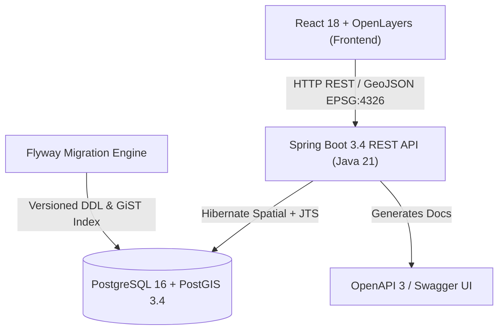

# LandMark - Interactive Real Estate GIS Platform

[](https://www.oracle.com/java/)
[](https://spring.io/projects/spring-boot)
[](https://www.postgresql.org/)
[](https://postgis.net/)
[](https://react.dev/)
[](https://openlayers.org/)
[](https://www.docker.com/)
[](https://github.com/Goguel/LandMark/actions)

**LandMark** is a modern, production-grade geospatial real estate web platform designed for advertising, discovering, and visualizing land plots on a high-precision dynamic map. Built with an uncompromising focus on geospatial precision, modern decoupled architecture, and intuitive user experience, LandMark allows users to draw real-world property boundaries, validate spatial overlaps natively through PostGIS, and perform interactive proximity searches.

---

## Summary

- [1. Core Platform Features](#1-core-platform-features)
- [2. Architecture & Engineering Highlights](#2-architecture--engineering-highlights)
  - [2.1. Spatial Overlap Logic: Why `ST_Dimension = 2`?](#21-spatial-overlap-logic-why-st_dimension--2)
  - [2.2. Geodesic Proximity on the WGS84 Ellipsoid](#22-geodesic-proximity-on-the-wgs84-ellipsoid)
  - [2.3. Flyway Versioning & `ddl-auto: validate`](#23-flyway-versioning--ddl-auto-validate)
  - [2.4. React 18 + OpenLayers Decoupled Overlay Architecture](#24-react-18--openlayers-decoupled-overlay-architecture)
- [3. Interactive API Documentation (Swagger / OpenAPI 3)](#3-interactive-api-documentation-swagger--openapi-3)
- [4. Preloaded Brazilian Land Catalog (Seed Data)](#4-preloaded-brazilian-land-catalog-seed-data)
- [5. Quick Start with Docker Compose (Recommended)](#5-quick-start-with-docker-compose-recommended)
- [6. Running Locally (Without Docker)](#6-running-locally-without-docker)
- [7. Testing & Code Coverage (>80%)](#7-testing--code-coverage-80)

---

## 1. Core Platform Features

- **Interactive Polygon Drawing**: Users draw parcel boundaries directly on the map. Vertices and geodesic areas (in m² and hectares) are calculated in real time.
- **Topological Overlap Detection**: The backend prevents double-allocation by validating that proposed plots do not overlap pre-existing lands (returns HTTP `409 Conflict`).
- **Dynamic Radius Proximity Search**: Users define custom circular search zones directly on the map by expanding a radius HUD in real time, filtering all intersecting plots.
- **Interactive Property Inspection**: Clicking any registered plot reveals property details, calculated dimensions, price in Brazilian Reais (`R$`), and seller contact.
- **High-Resolution Multi-Basemaps**:
  - 🌙 **Dark Minimal** (Esri Canvas Dark with continuous overzooming)
  - 🌐 **Google Hybrid** (Ultra high-res aerial satellite photography with street names up to zoom 21, perfect for house-level parcels)
  - 🏘️ **Streets & Parcels** (Esri World Street Map with urban blocks and parcel outlines)
  - 🛰️ **Satellite** (Esri World Imagery)
  - ☀️ **Light Minimal** (Esri Canvas Light)
  - 🗺️ **Standard OSM** (OpenStreetMap)
- **Automatic Form Reset & Resilience**: Plot registration forms reset cleanly on every interaction, and an integrated React `ErrorBoundary` ensures display continuity.
- **Preloaded Brazilian Land Catalog**: 8 diverse land plots (residential house, commercial city block, logistics park, beachside plot, and large-scale agricultural farms) seeded automatically on startup.

---

## 2. Architecture & Engineering Highlights



### 2.1. Spatial Overlap Logic: Why `ST_Dimension = 2`?
A common pitfall in GIS development is calling `ST_Intersects` blindly. If two adjacent property plots share a common boundary line (fence/wall) or a single corner vertex, `ST_Intersects` returns `true`. In the real world, **neighboring plots naturally touch boundaries**!

LandMark implements mathematically sound topological validation in [LandPlotRepository.java](backend/src/main/java/com/landmark/api/repository/LandPlotRepository.java):
```sql
SELECT CASE WHEN COUNT(l.id) > 0 THEN true ELSE false END
FROM land_plots l
WHERE ST_Intersects(l.geometry, :geometry) = true
  AND ST_Dimension(ST_Intersection(l.geometry, :geometry)) = 2
```
- **Dimension 0 (Points)**: Shared corner vertices between lots &rarr; **Permitted**
- **Dimension 1 (Lines)**: Shared property boundary borders &rarr; **Permitted**
- **Dimension 2 (Polygons)**: True spatial area overlap &rarr; **Rejected (HTTP 409 Conflict)**

### 2.2. Geodesic Proximity on the WGS84 Ellipsoid
When searching within a radius, Euclidean degree distances produce severe distortion. LandMark casts geometries to PostGIS `geography` types:
```sql
ST_DWithin(
    CAST(l.geometry AS geography),
    CAST(ST_SetSRID(ST_Point(:longitude, :latitude), 4326) AS geography),
    :radiusInMeters
)
```
This guarantees that a 5,000m radius search covers exactly 5,000 real meters on the curved Earth spheroid.

### 2.3. Flyway Versioning & `ddl-auto: validate`
Instead of brittle runtime DDL manipulation (`ddl-auto: update`), the database schema is strictly managed via **Flyway migrations** (`V1__create_spatial_schema.sql`):
- Explicit PostGIS extension activation (`CREATE EXTENSION IF NOT EXISTS postgis`).
- Spatial GiST index creation (`CREATE INDEX idx_land_plots_geometry ON land_plots USING GIST (geometry)`).
- Hibernate runs in `validate` mode to ensure strict schema adherence without unexpected schema drift.

### 2.4. React 18 + OpenLayers Decoupled Overlay Architecture
OpenLayers overlays reparent DOM elements into its internal viewport container. In React 18, inserting conditional JSX siblings (such as the live radius HUD) next to reparented elements causes DOM reconciliation exceptions (`NotFoundError: insertBefore`). 

LandMark decouples the overlay container from the React JSX reconciliation tree using `createPortal(content, overlayDomNode)`, eliminating reconciliation crashes permanently.

---

## 3. Interactive API Documentation (Swagger / OpenAPI 3)

The backend provides complete **Swagger UI** documentation with interactive testing capabilities:

- **Swagger UI**: [http://localhost:8080/swagger-ui.html](http://localhost:8080/swagger-ui.html)
- **OpenAPI JSON Spec**: [http://localhost:8080/v3/api-docs](http://localhost:8080/v3/api-docs)

### API Endpoints Summary

| Method | Endpoint | Description |
|---|---|---|
| `POST` | `/api/plots` | Register a new land plot (validates 2D overlap and calculates area) |
| `GET` | `/api/plots` | List all registered land plots with GeoJSON geometries |
| `GET` | `/api/plots/{id}` | Retrieve single land plot details by UUID |
| `GET` | `/api/plots/search/radius` | Proximity search by radius (`longitude`, `latitude`, `radiusInMeters`) |
| `POST` | `/api/plots/search-by-geometry` | Search plots intersecting an arbitrary GeoJSON polygon |
| `DELETE` | `/api/plots/{id}` | Delete a land plot by UUID |

> **Note**: Both `/api/plots` and `/api/lands` routing prefixes are supported interchangeably.

---

## 4. Preloaded Brazilian Land Catalog (Seed Data)

Upon startup, `LandPlotDataLoader` automatically populates the database with 8 representative properties:

| # | Location | Title | Type / Scope | Calculated Area | Price (R$) |
|---|---|---|---|---|---|
| 1 | **São Paulo (Jardins)** | Lote Residencial Jardins - Al. Lorena | Residential House Lot | **623 m²** | R$ 3.850.000,00 |
| 2 | **São Paulo (Faria Lima)** | Quadra Corporativa Faria Lima - Itaim Bibi | Commercial City Block | **10.198 m²** (~1 ha) | R$ 95.000.000,00 |
| 3 | **São Paulo (Rodoanel)** | Parque Logístico Rodoanel Oeste | Industrial Logistics Park | **68.030 m²** (6.8 ha) | R$ 28.500.000,00 |
| 4 | **Natal (RN - Ponta Negra)** | Terreno Frente-Mar Ponta Negra | Beachfront / Hospitality | **36.898 m²** (3.6 ha) | R$ 4.200.000,00 |
| 5 | **Goiás (Rio Verde)** | Fazenda Santa Fé - Soja e Milho | Grain Farm | **12.364.538 m²** (1.236 ha) | R$ 78.000.000,00 |
| 6 | **Pantanal / MS (Miranda)** | Mega Fazenda Pantanal Sul | Mega Cattle & Crop Farm | **93.008.373 m²** (9.300 ha) | R$ 165.000.000,00 |
| 7 | **Curitiba (PR - Batel)** | Terreno de Esquina Ecoville / Batel | High-Rise Residential Lot | **55.828 m²** (5.5 ha) | R$ 14.800.000,00 |
| 8 | **Mantiqueira (Campos do Jordão)**| Sítio Alto da Mantiqueira | Ecotourism / Mountain Farm | **1.139.990 m²** (114 ha) | R$ 3.200.000,00 |

---

## 5. Quick Start with Docker Compose (Recommended)

The entire fullstack ecosystem (PostgreSQL/PostGIS, Spring Boot API, and React Frontend) starts with a single command.

### Prerequisites
- [Docker Desktop](https://www.docker.com/) (version 24+)

### 1. Environment Configuration (`.env`)
The platform follows the **Twelve-Factor App (Config)** standard. Infrastructure settings, database credentials, ports, and the 256-bit JWT cryptographic key are managed via environment variables.

To customize settings, copy the provided template to create your `.env` file:
```bash
# Linux / macOS
cp .env.example .env

# Windows (PowerShell)
copy .env.example .env
```

> **Note**: Sensible fallback defaults are preconfigured for local development, so Docker Compose runs out of the box even without creating `.env`.

### 2. Build and Launch
```bash
# 1. Clone the repository
git clone https://github.com/Goguel/LandMark.git
cd LandMark

# 2. Build and launch all services
docker compose up --build
```

### Access URLs
- **Web Application**: [http://localhost:3000](http://localhost:3000)
- **Swagger UI**: [http://localhost:8080/swagger-ui.html](http://localhost:8080/swagger-ui.html)
- **Backend API**: [http://localhost:8080/api/plots](http://localhost:8080/api/plots)
- **PostgreSQL PostGIS**: `localhost:5432` (`landmark_db`, user: `landmark_user`, pass: `landmark_pass`)

---

## 6. Running Locally (Without Docker)

### Prerequisites
- **Java JDK 21+**
- **Node.js 20+** & **npm**
- **PostgreSQL 16+** with **PostGIS** extension

### 1. Environment Configuration (`.env`)
Generate your local `.env` configuration file from the template:
```bash
# Linux / macOS
cp .env.example .env

# Windows (PowerShell)
copy .env.example .env
```
The backend automatically detects and loads properties from `.env` on startup via `springboot-dotenv`.

### 2. Database Setup
```sql
CREATE DATABASE landmark_db;
\c landmark_db;
CREATE EXTENSION IF NOT EXISTS postgis;
```

### 3. Backend
```bash
cd backend
./mvnw spring-boot:run
```
The API starts on port `8080`.

### 4. Frontend
```bash
cd frontend
npm install
npm run dev
```
The client starts on [http://localhost:5173](http://localhost:5173).

---

## 7. Testing & Code Coverage (>80%)

Both frontend and backend include automated test suites exceeding the 80% coverage requirement.

### Backend Tests (JaCoCo)
```bash
cd backend
./mvnw clean test
```
- **42 Automated Tests** covering Controllers, Services, Utilities, DataLoader, and OpenAPI configurations.
- **JaCoCo Coverage**: > 94% instruction and line coverage.
- Report location: `backend/target/site/jacoco/index.html`

### Frontend Tests (Vitest + React Testing Library)
```bash
cd frontend
npm test
```
- **68 Automated Tests** covering Drawing interactions, Error Boundary recovery, Popup rendering, Modals, Sidebar, and API integration.
- Report location: `frontend/coverage/index.html`
